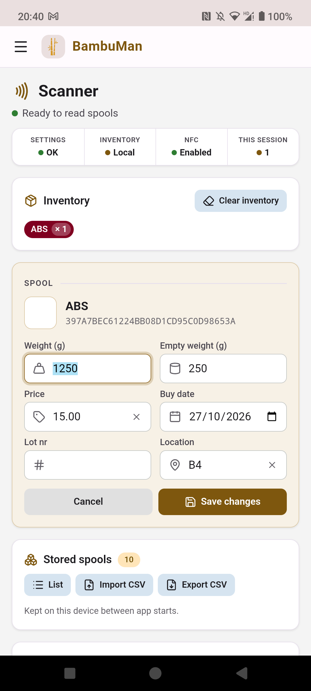
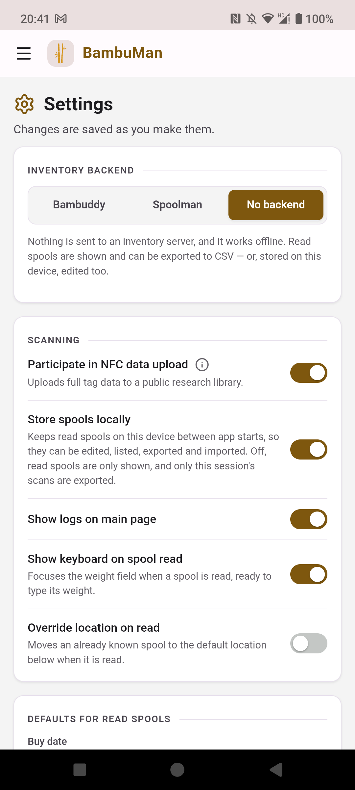
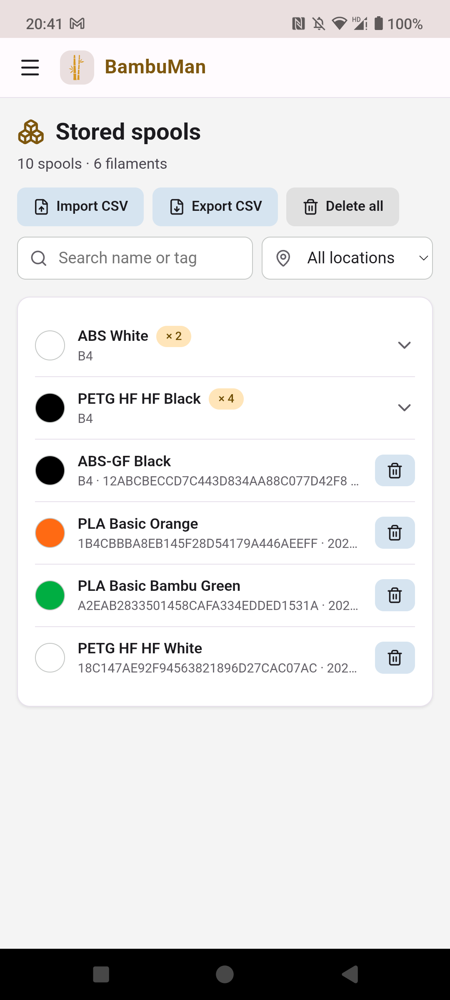
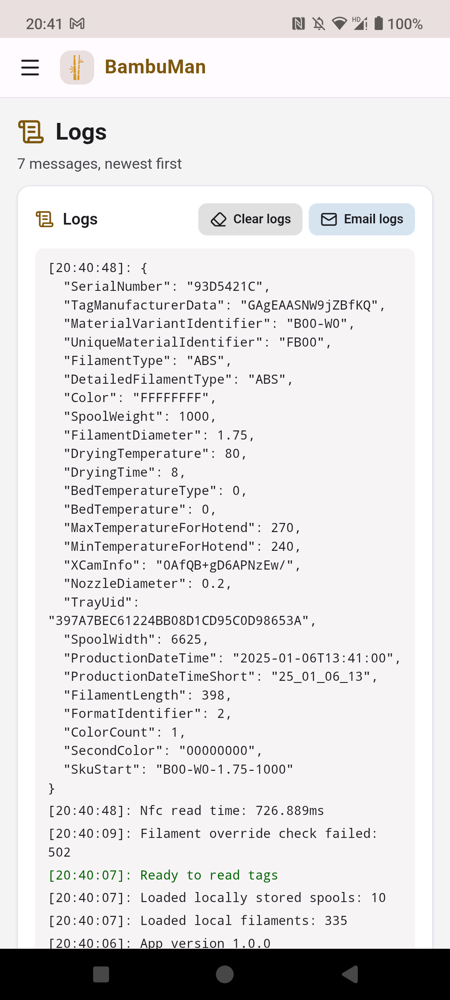
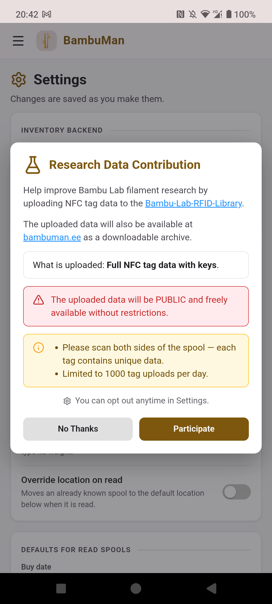
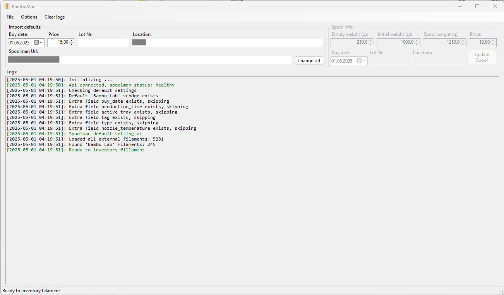
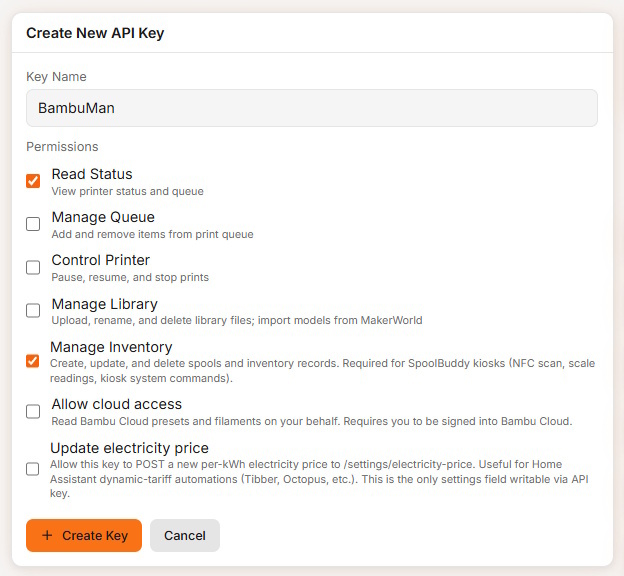
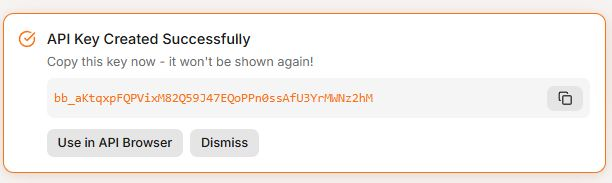
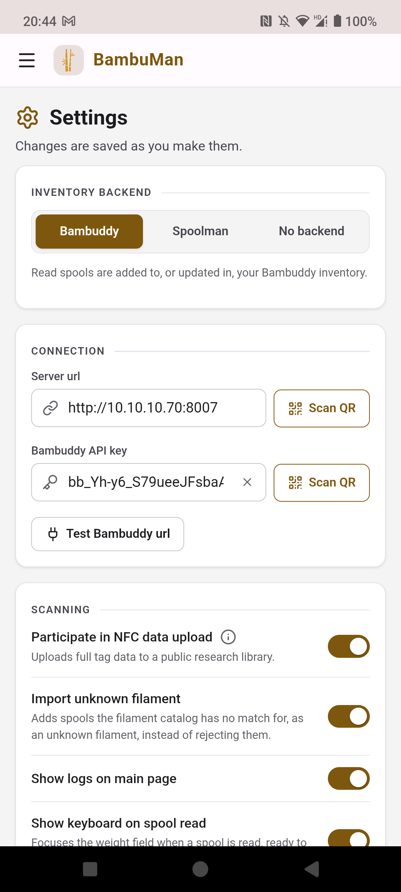
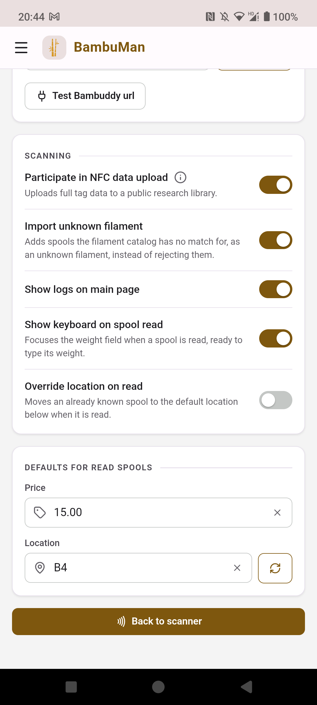

#  BambuMan

BambuMan imports `Bambu Lab` filament spools into your inventory by reading their `NFC` tag. It supports two inventory backends — [bambuddy](https://bambuddy.cool) and [Spoolman](https://github.com/Donkie/Spoolman) — selectable in the app settings (Android) or the `Options` menu (Windows). With **No backend** it works fully offline: read spools stay on the device, can be exported to a CSV file that bambuddy imports, and can later be sent straight to bambuddy or Spoolman.

The app tries to match the tag info with the existing [SpoolmanDB](https://github.com/Donkie/SpoolmanDB) entry. When a match is found, the app creates the filament and spool. Imported spools will have the same `tray_uuid` as the `AMS` reports over `MQTT`.

If you use [bambuddy](https://bambuddy.cool) ([GitHub](https://github.com/maziggy/bambuddy)) or [OpenSpoolMan](https://github.com/drndos/openspoolman) to track your filament usage, it will be able to automatically match the spool inserted into the `AMS`, no additional action is necessary.

## Download

| Google Play | F-Droid |
|:---:|:---:|
|  |  |

> **Note:** Google Play updates may arrive 1–7 days after the GitHub/F-Droid release due to Google's review process.

## Features

 - **NFC tag reading** on Android (built-in NFC) and Windows desktop (PCSC compatible reader)
 - **Third-party spool tags** — besides Bambu Lab tags, reads [OpenSpool](https://github.com/spuder/OpenSpool) (NTAG215/216, NDEF JSON) and [TigerTag](https://github.com/TigerTag-Project/TigerTag-RFID-Guide) (NTAG21x) tags on Android and Windows, matches them to known filaments by brand, material and colour, and inventories them like any other spool (the tag UID identifies the spool)
 - **Write OpenSpool tags** (Android) — put an OpenSpool tag on a spool that has none, from a filament entered by hand or copied from the last read spool
 - **Two inventory backends** — choose [bambuddy](https://bambuddy.cool) or [Spoolman](https://github.com/Donkie/Spoolman) in the settings
 - **No backend mode** — works offline, no inventory server needed
 - **Offline scan queue** — a spool read while the bambuddy or Spoolman server can't be reached (server down, phone away from the home network) is kept on the device and sent automatically, in scan order, once the server is back; queued scans can be listed, sent again or discarded
 - **Stored spools** — keep read spools on the device, search and filter them by name, tag or location, edit or delete them
 - **CSV export / import** — the export uses bambuddy's CSV columns, so it imports straight into bambuddy (`Inventory` → `Import CSV`)
 - **Send stored spools to a server** — once bambuddy or Spoolman is set up, send the stored spools there; spools the server already has are updated instead of added twice
 - **Automatic filament matching** with SpoolmanDB — covers most Bambu Lab filaments; unmatched spools can optionally be added as an unknown filament
 - **Add spool manually** — for a spool whose tag can't be read (foil bag, damaged tag): search the Bambu Lab filament list by material, name or colour, or enter it as an unknown filament, and save it with its weight, price and location
 - **Inventory tracking** — groups scanned spools by material with AMS tray UID tracking
 - **Quick weighing** — optionally focuses the weight field when a spool is read, and can move already known spools to the default location
 - **Bluetooth scale** (Android) — fills in a read spool's weight from a Bluetooth LE scale: a DIY scale speaking the [BambuMan scale protocol](docs/scale-protocol.md) (ESP32 + HX711 example included) or a scale with the standard Weight Scale Service
 - **Research Data Contribution** — opt-in NFC tag data upload to the [bambuman.ee](https://bambuman.ee) tag library
 - **QR code scanner** for quick backend URL and API key setup
 - **Configurable import defaults** — buy date, price, lot number, location
 - **Log viewer** with email export for troubleshooting
 - **Auto-setup** — creates required extra fields and default vendor in Spoolman

## The app is available in two versions

 - **Android** application (your phone has to support `NFC`)

   | Main | Settings | Stored spools | Logs | Research Data Contribution |
   |:---:|:---:|:---:|:---:|:---:|
   |  |  |  |  |  |

 - **Windows** desktop application (a `PCSC` compatible `NFC` reader like [ACR122U](https://www.acs.com.hk/en/products/3/acr122u-usb-nfc-reader/) or [ACR1252U](https://www.acs.com.hk/en/products/342/acr1252u-usb-nfc-reader-iii-nfc-forum-certified-reader/) is needed)

   

## How to setup

### Android — bambuddy

The Android app can inventory into [bambuddy](https://bambuddy.cool). Pick the backend with the selector at the top of the settings page.

1. In bambuddy, create an API key with **both** the **Manage Inventory** and **Read Status** permissions:
	 - **Manage Inventory** — lets BambuMan create and update spools (what the `NFC` scan writes).
	 - **Read Status** — lets BambuMan list spools, so re-scanning a tag updates the existing spool instead of creating a duplicate.

	 

2. Copy the generated key.

	 

3. In BambuMan settings, switch the backend to **bambuddy**, enter the bambuddy address (for example `http://host:8000`), then scan or paste the API key.

	  

4. Go back to the scanner. Once the `Settings`, `Inventory` and `NFC` status tiles are green, you can start reading `NFC` tags.

> **Tip:** The API key is long and awkward to type on a phone. On your computer, turn the URL or key into a QR code with a free, no-signup generator like [QRCode Monkey](https://www.qrcode-monkey.com/#text), then scan it with the in-app **scan** button. The API key is a secret, so only paste it into a generator you trust.

> **Note:** bambuddy spools have no *Buy date* or *Lot nr*, so those import options are hidden in bambuddy mode. The matched Bambu filament also sets the bambuddy slicer preset automatically.

### Android — Spoolman
 1. Install from [Google Play](https://play.google.com/store/apps/details?id=com.noismaster.bambuman), [F-Droid](https://bambuman.github.io/repo), or download the APK manually from GitHub releases.
 2. Go to settings and scan the Spoolman URL with QR code or enter it manually.
	 - BambuMan supports basic authentication, URL format `http[s]://username:password@host[:port]/`
	 - If the password contains special characters (like `@` `:`) it must be URL encoded
 3. Go back to main window. BambuMan will connect to Spoolman and create the necessary extra fields and default vendor.
 4. Once the `Settings`, `Inventory` and `NFC` status tiles are green, you can start reading `NFC` tags.

### Android — No backend

 1. In BambuMan settings, switch the backend to **No backend**. Nothing is sent to an inventory server.
 2. Turn on **Store spools locally** to keep read spools between app starts. Off, read spools are only shown, and only the current session's scans are exported.
 3. Read `NFC` tags. Stored spools are listed on the **Stored spools** page, where they can be edited, deleted, and exported or imported as CSV.
 4. To move them into bambuddy or Spoolman, set that backend up in settings (see above). The stored spools stay on the device, and **Spools** stays in the menu while there are any. On the **Stored spools** page, **Send to bambuddy / Spoolman** sends the spools the filters show (or open a spool to send just that one). Each goes through the same path as reading its tag — filament matching, and a spool the server already has for that tag is updated rather than added twice — with its stored weight, price, location, buy date and lot nr (bambuddy has no buy date or lot nr). The one exception is the weight of a spool the server already has: when the stored weight would leave more filament on it than the server has (e.g. it was printed from since it was stored), the server keeps its own weight, so a send never adds used filament back. A summary lists what was created, updated (and where the server's weight was kept) or failed and why. Sent spools are kept on the device, marked as sent (the filter can show the ones not sent yet); delete them once you no longer need them. Editing a spool after sending marks it as not sent again.
    - Spoolman has no CSV import, so this is the way to move stored spools into Spoolman. For bambuddy, **Export CSV** and bambuddy's `Inventory` → `Import CSV` still work too.

### Android — Bluetooth scale

 1. In BambuMan settings, turn on **Weigh with a Bluetooth scale** under **Bluetooth scale** and allow the Bluetooth (*Nearby devices*) permission. On Android 11 and older Android asks for location instead, which it requires for any Bluetooth scan; location services must be on while searching.
 2. Turn the scale on, tap **Find scale** and **Use** next to it. BambuMan remembers it, connects whenever it is in reach, and shows its live weight in the settings.
 3. Put a spool on the scale, then read its tag: the spool card's weight is filled from the scale (a settled, stable weight is preferred). It stays editable — once you type a weight, the scale no longer changes it.
	 - The scale should show everything on it — filament **and** spool. That's what the weight field means for every backend; BambuMan takes the *Empty weight* off itself. So tare the scale empty, not with an empty spool on it.
 4. Supported are scales that offer the standard Bluetooth **Weight Scale Service**, and DIY scales that speak the **BambuMan scale protocol** — see [docs/scale-protocol.md](docs/scale-protocol.md) for the protocol and an ESP32 + HX711 sketch. Most kitchen scales use their maker's own protocol and are not found.

The Windows desktop app has no Bluetooth scale support.

### Windows

 1. You will need [.NET Desktop Runtime 10](https://dotnet.microsoft.com/download/dotnet/10.0) installed
 2. Download the released `BambuMan.exe` or compile from source
 3. Pick the backend in `Options` → `Backend`: **Bambuddy**, **Spoolman** or **No backend**
 4. Bambuddy: paste the bambuddy address (for example `http://host:8000`) and the API key (created as described in [Android — bambuddy](#android--bambuddy)), then click `Connect`
	 - You can also paste bambuddy's setup link (`bambuddy://config?...`) into the url box; `Connect` fills in both fields
 5. Spoolman: paste the Spoolman URL and click `Connect`
	 - BambuMan supports basic authentication, URL format `http[s]://username:password@host[:port]/`
	 - If the password contains special characters (like `@` `:`) it must be URL encoded
	 - The app connects to Spoolman and creates the necessary extra fields and default vendor.
 6. Once the status bar shows `Ready to inventory fillament`, you can start reading `NFC` tags. A scanned spool is created in the backend, or found again by its tag if it is already there, and its weight, price and location can be edited in the spool panel.
 7. No backend: scanned tags are only shown in the log. `Options` → `Store spools locally` keeps them on the computer, and `File` → `Export CSV...` writes them to a file that bambuddy can import.
	 - With spools stored locally, `File` → `Stored spools...` lists them: search by name or tag, filter by location, edit a spool (double-click it: weight, empty weight, price, buy date, lot nr, location), delete spools, and import or export CSV
	 - `File` → `Import CSV...` adds the spools of a BambuMan export to the stored spools; a spool already stored is replaced
	 - After switching to Bambuddy or Spoolman, `File` → `Stored spools...` can send them there (all, or the selected rows)

## F-Droid repository

If you have F-Droid installed on your phone, you can install BambuMan from our F-Droid [repository](https://bambuman.github.io/repo).

## NFC Tag Library

Contributed NFC tag data is publicly available at [bambuman.ee](https://bambuman.ee). You can browse the library or download the full archive.

To participate, enable **Research Data Contribution** in the app settings. Uploaded data is publicly available without restrictions.

## Known limitations

 - You can't read filaments in foil bags! The foil blocks the NFC signal. Add them with **Add spool** on the scanner page (Android) or `File` → `Add spool manually...` (Windows) instead. A spool added this way has no tag, so scanning its tag later (once the bag is open) adds it again as a new spool rather than finding the one added by hand — link the tag to it in bambuddy or Spoolman, or delete the one added by hand. In **No backend** mode, adding by hand needs **Store spools locally**.
 - Most Bambu Lab filaments are supported including 
	- PLA (Basic, Matte, Silk+, Wood, Glow, Aero, Sparkle, Tough+)
	- PETG (HF, Transparent, Translucent), 
	- ABS, ABS-GF, ASA, ASA-CF, PA6-GF, PA6-CF, PAHT-CF, TPU, PC, PVA, Support filaments, and multi-color spools. 
 - Some niche variants may still need manual matching.
 - Third-party tags (OpenSpool, TigerTag):
	- are read on Android and, with a PC/SC reader that reports NTAG as MIFARE Ultralight (e.g. ACR122U), on Windows. iOS is untested, and can't read TigerTag (no raw page access).
	- carry no spool id, so each tag is its own spool. A spool with a tag on both sides counts twice unless only one side is scanned.
	- only match a known filament when the catalog has that brand, material and exact colour. The embedded catalog has Bambu Lab filaments only; Spoolman also matches against its full external filament database. Anything else goes the unknown filament path (Spoolman needs "Import unknown filament" turned on; bambuddy and no backend mode add the spool with the tag data).
	- are never uploaded to the tag library, whatever the Research Data Contribution setting.
	- TigerTag signatures (TigerTag+ Certified) are not verified, and resin / non-filament TigerTags are ignored.
 - Writing OpenSpool tags needs an NDEF-formatted NTAG215/216 (blank tags usually are). It replaces whatever the tag holds, and refuses Bambu Lab tags and TigerTags.

## Tested with

  - [bambuddy](https://bambuddy.cool) v0.2.4.5+ (recommended)
  - [Spoolman](https://github.com/Donkie/Spoolman) v0.22.1, v0.23.0, v0.23.1
  - [OpenSpoolMan](https://github.com/drndos/openspoolman) v0.1.8

## Roadmap

 - Make extra fields optional
 - More intuitive UI

## Big thanks to
- [Bambu-Research-Group](https://github.com/Bambu-Research-Group) for reverse engineering the NFC tag specification
- [Plugin.NFC](https://github.com/franckbour/Plugin.NFC) for providing a plugin to use NFC in MAUI

## License

This project is licensed under the [AGPL-3.0 License](LICENSE).
